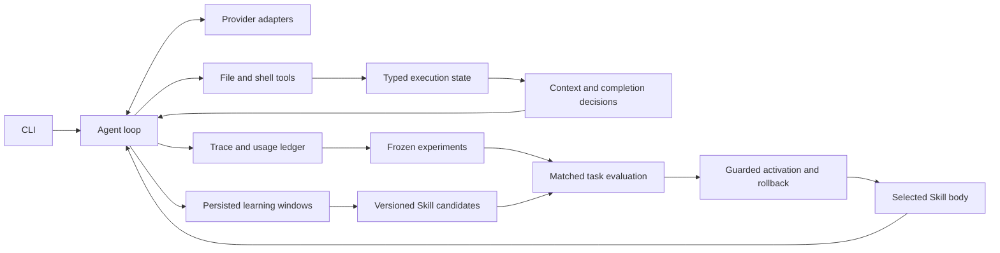

# Architecture

The model proposes actions. The runtime executes tools, records their outcomes and constructs the next request. Research adapters change context and evaluation policies around that runtime.

| Boundary | Source | Responsibility |
|---|---|---|
| Entry and terminal | [main.py](../agents/main.py), [cli_shell.py](../agents/cli_shell.py), [cli_display.py](../agents/cli_display.py) | Configuration, sessions, interactive commands and presentation |
| Model loop | [agent.py](../agents/agent.py) | Provider calls, tool ordering, budgets, incomplete output and context transitions |
| Execution facts | [tool_result.py](../agents/tool_result.py), [repair_state.py](../agents/repair_state.py), [verification.py](../agents/verification.py) | Structured tool outcomes, task/execution identity, scoped checks and current-code verification |
| Context | [session_memory.py](../agents/session_memory.py), [observed_pages.py](../agents/observed_pages.py), [working_set.py](../agents/working_set.py) | Conversation boundaries and bounded, versioned observations |
| Procedural memory | [skills.py](../agents/skills.py), [skill_evolution.py](../agents/skill_evolution.py), [online_skill_evolution.py](../agents/online_skill_evolution.py) | Discovery, loading, updates and execution-grounded extraction |
| Memory lifecycle | [session.py](../agents/session.py), [skill_activation.py](../agents/skill_activation.py) | Atomic learning checkpoints, workspace scope, evaluated version installation and guarded rollback |
| Candidate evaluation | [online_skill_eval.py](../agents/online_skill_eval.py) | Frozen replay samples, current baseline, candidate ranking and promotion records |
| Observability | [telemetry.py](../agents/telemetry.py) | Correlated events, content-addressed payloads and provider usage |
| Experiments | [context_folding.py](../benchmarks/context_folding.py), [folding_checkpoint.py](../benchmarks/folding_checkpoint.py), [continuation_folding.py](../benchmarks/continuation_folding.py) | Opt-in context strategies and deterministic evidence projection |

`Agent` is the native CLI runtime. Experimental loop subclasses are selected by benchmark callers. Source-window projection utilities and staged executable evaluation need their caller integration; module availability alone does not make a policy active in every session.

Execution receipts bind evidence to an execution and repository state. Model-authored summaries retain implementation knowledge but cannot turn a failed check into a pass. A public test result establishes only the behavior that test exercised. Independent benchmark grading remains outside the solving agent.

`experiment/` holds outputs and curated evidence. Credentials, complete model payloads, downloaded workspaces and teaching material stay in ignored local storage. Frozen artifacts retain their original bytes and source identities.
